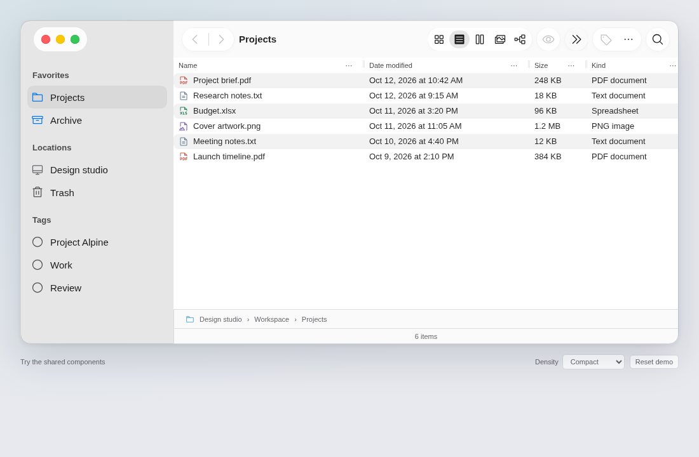
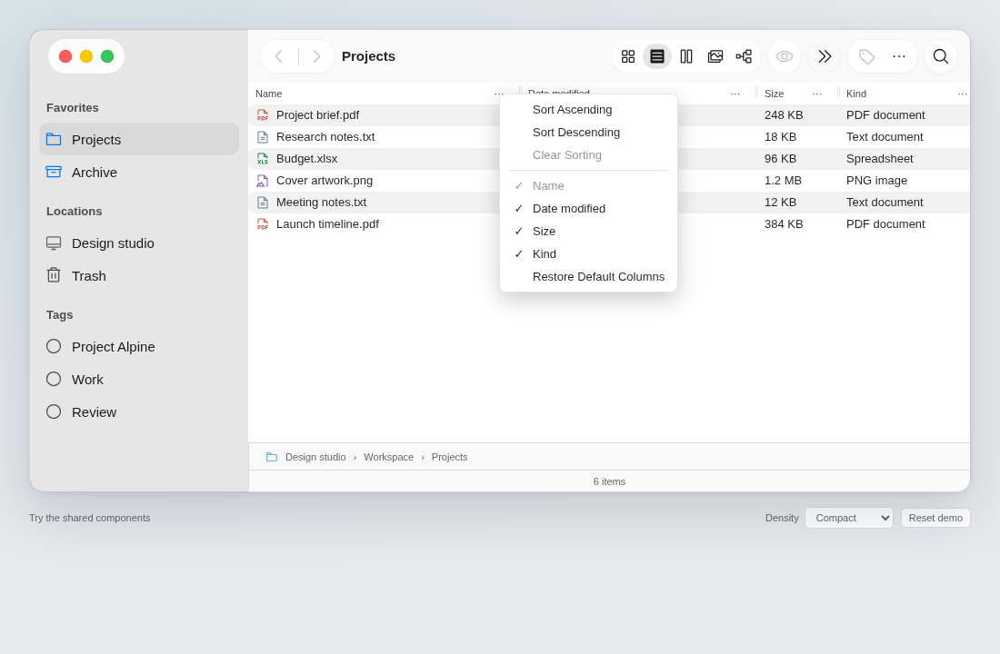
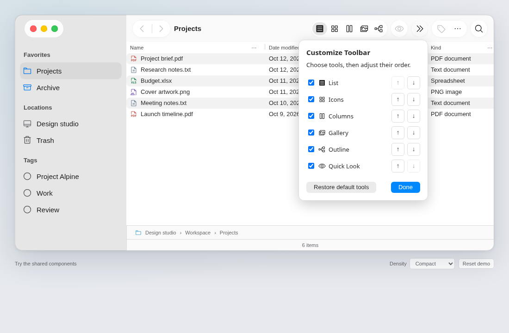
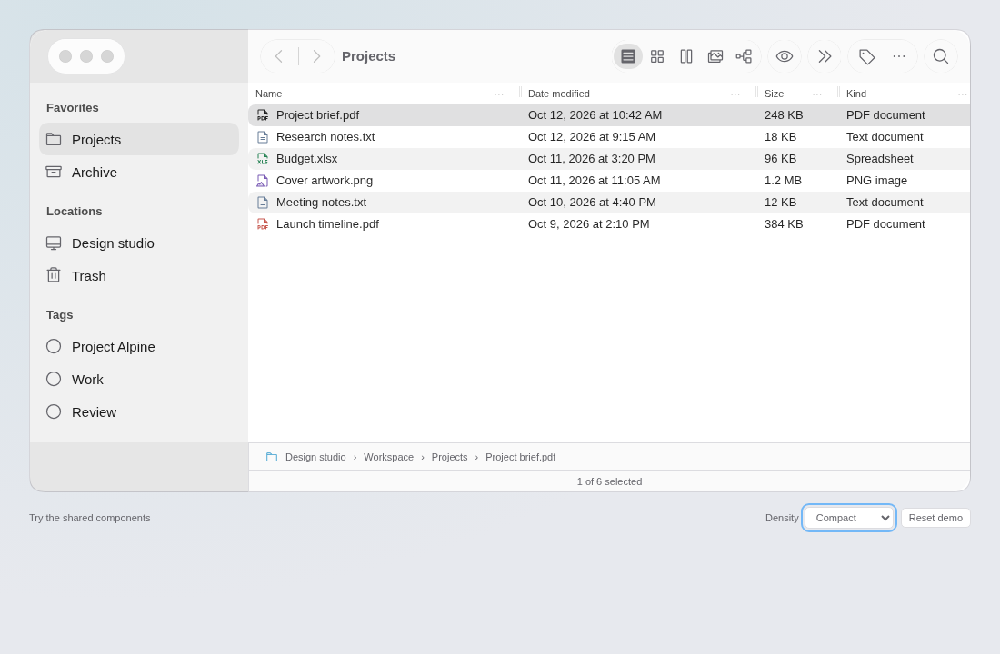
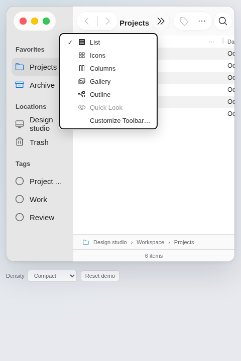

# Finder review with Agent Browser

Reviewed 2026-10-14 with Agent Browser 0.39.1 and Chromium, using the current
Storybook build. Screenshots below were captured and inspected in this review.
The comparison source is Apple's [Tahoe 26 Finder toolbar](https://support.apple.com/guide/mac-help/customize-the-finder-toolbar-on-mac-mchlp3011/26.0/mac/26.0),
whose published image was also opened in Agent Browser.

The layout and interactions now follow Finder more closely. History stays by
the location title, optional tools have an overflow route, and inactive windows
retain neutral selection. The first review found clipping, a disappearing
compact title, ambiguous ellipsis buttons, and reorder focus loss; these were
corrected before accepting the captures. A second pass found focus loss when a
focused tool entered overflow and a customization panel that stayed at its old
position after resizing. Both are fixed and covered by browser regressions.

## 1. Desktop toolbar — healthy

Navigation, title, tool groups and Search have clear positions. Views share one
capsule; Preview and overflow have their own controls. Header command buttons
appear on hover or keyboard focus on desktop, keeping the resting list quiet. Double chevrons
distinguish overflow from the Actions ellipsis. The demo has extra Outline and
Quick Look tools beyond Apple's four view controls; customization can remove
them. Native macOS font metrics and optical icon spacing still differ.

## 2. Header commands — healthy

Sorting and column visibility are reachable without finding another settings
panel. Checked states expose actual menu semantics, Name remains required, and
restore defaults is explicit. Right-click and Shift+F10 provide alternatives to
the small visible button. The wide table retains horizontal scrolling.

## 3. Customize tools — healthy

Moving List earlier changes both the toolbar and the visible editor order.
Boundary moves return focus to the tool's checkbox instead of leaving the
window inactive. Choose/remove, reorder and restore are keyboard-accessible.
The editor now includes icon previews and Done, restores focus on completion,
and stays inside the viewport even at 320 × 360. The explicit editor differs from Apple's drag-based customization sheet; adding
pointer drag ordering would be a useful next refinement. Persistence belongs
to the app through controlled IDs.

## 4. Inactive selection — healthy

Focus on the external density control dims the window and makes selection
neutral. The status still reads **1 of 6 selected**. Re-entering the window or
opening an owned menu restores active chrome. This is focus-based web window
styling, rather than an OS window-manager implementation.

## 5. Compact overflow — healthy, with a web adaptation

At 480px, history, title and Search remain visible while view choices and Quick
Look move to a checked menu. There is one actionable instance of each optional
tool. At 390px, pinned controls may wrap; this keeps them reachable below native
desktop window widths. A resize regression also guards against transient page
overflow while tool measurements update.

## Validation and limits

Browser checks cover keyboard sorting/column choices, required Name, restored
columns, preserved inactive selection, owned menu focus, customization/order/
reset, focus transfer into overflow, customization bounds after resize, RTL
toolbar navigation, and compact accessibility scans at 480px and
390px. The README includes a new 21-second Finder workflow: header sorting/columns,
customization, and selection retained in Gallery. Capture assertions verify each
step; regenerate it with `node scripts/capture-readme.mjs --tools` after building
Storybook. Screenshots alone do not establish accessibility conformance.

Agent Browser reports no hover-capable pointer in this environment, so its
captures keep header command buttons visible. The desktop Playwright captures
show the quieter resting headers.

The visual comparison uses Apple's published Tahoe toolbar image, not a running
Mac. Native Liquid Glass refraction, SF font metrics, VoiceOver behavior and OS
window activation require testing on macOS. The remaining visual priorities are
native typography/spacing and pointer-based customization, rather than more
glass effects.
