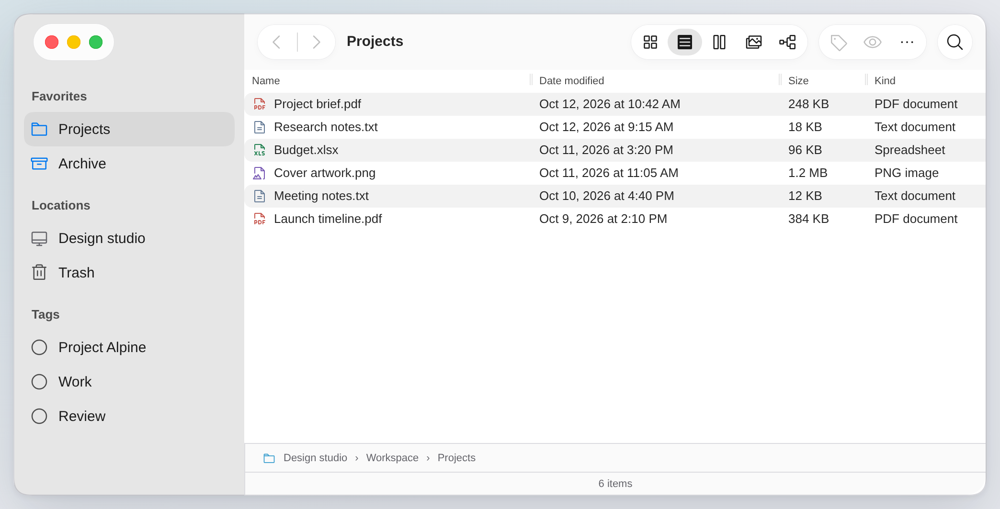
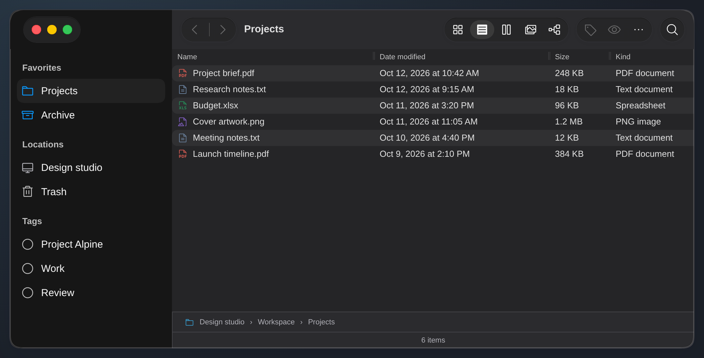

# Closer to macOS Tahoe Finder

Reviewed 2026-10-14. The visual reference is Apple's **macOS Tahoe 26** guide;
its version is pinned because the unversioned guide now defaults to macOS 27.

## What Apple shows

- [Finder toolbar, Tahoe 26](https://support.apple.com/guide/mac-help/customize-the-finder-toolbar-on-mac-mchlp3011/26.0/mac/26.0): history next to the folder title, four grouped view controls, separate command groups, and search at the trailing edge. Toolbar customization supports adding, removing and rearranging items; overflow keeps hidden items reachable in a small window.
- [Human Interface Guidelines: toolbars](https://developer.apple.com/design/human-interface-guidelines/toolbars): group by function, avoid overcrowding, preserve navigation and important trailing actions, and use familiar monochrome symbols. The native system manages overflow; a web component must implement its own equivalent.
- [Human Interface Guidelines: materials](https://developer.apple.com/design/human-interface-guidelines/materials): Liquid Glass belongs to the navigation/control layer. Content should remain clear, and contrast and reduced-transparency preferences must remain usable.
- [Tahoe announcement](https://www.apple.com/newsroom/2025/06/macos-tahoe-26-makes-the-mac-more-capable-productive-and-intelligent-than-ever/): translucent navigation and sidebar elements are central to the new appearance.
- [WAI toolbar pattern](https://www.w3.org/WAI/ARIA/apg/patterns/toolbar/): a labeled toolbar can use one Tab stop and arrow navigation; text-entry controls retain their editing keys.

## Changes in this library

| Light | Dark |
| --- | --- |
|  |  |

`FinderWindow appearance="tahoe"` uses softer control capsules, a larger window
radius, and continuous sidebar/titlebar chrome. The original `classic` skin
remains the default. Examples use Tahoe; callers can opt in without changing
their content or state ownership.

`FinderToolbar keyboardNavigation` adds a single Tab entry, Left/Right movement,
Home/End, remembered focus, and skipping disabled or hidden controls. It handles
dynamic search and commands, respects right-to-left layout, and leaves input
editing and modified shortcuts alone. Ordinary Tab navigation remains available
by omitting the option. Toolbar and button labels make custom icon commands
discoverable to assistive technology and through native hover hints.

Compact windows retain Back and Forward. Groups wrap with their hit areas intact
instead of silently removing history. This is an intentional web adaptation;
it is not Apple's native overflow behavior.

## Next steps

1. **Overflow and customization:** keep history, the location title and Search pinned; move optional command groups into an accessible menu when they no longer fit. Let apps own the chosen commands and saved order. Avoid duplicating focusable commands or dropping disabled-state explanations.
2. **Search scope:** compose current-folder and workspace scopes with clear result counts and a reliable way back. The app owns indexing and results.
3. **Window state and materials:** add an explicit inactive-window appearance and test it against real Tahoe light/dark captures, reduced transparency, increased contrast and keyboard focus.

The CSS skin approximates the geometry and hierarchy of Apple's screenshot.
Browser blur cannot reproduce native Liquid Glass refraction or system vibrancy.
Phosphor symbols stay replaceable; the package does not redistribute SF Symbols.
Validate future changes against a real Tahoe window before claiming exact parity.
